# Gallery

Maps made by yr-mapgen, rendered with [LightningMap](https://github.com/11EJDE11/LightningMap). Red
circles are the start positions.

| | |
|---|---|
| 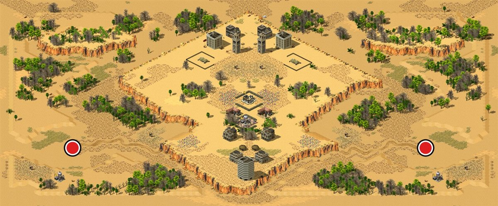 | 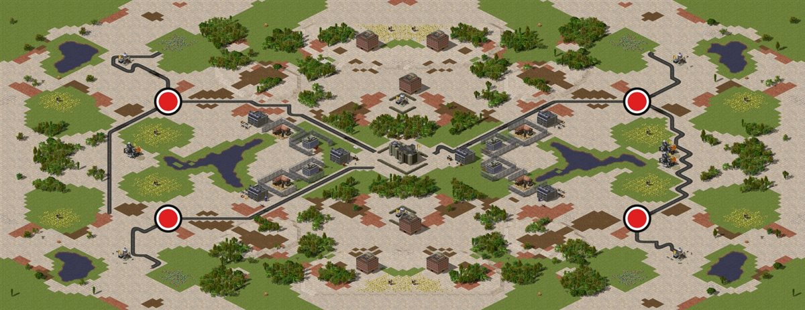 |
| **Mesa, 1v1, desert.** The centre is raised, with ramps up from each side. | **2v2, urban.** Ground patches, ponds, villages and paved trails. |
| 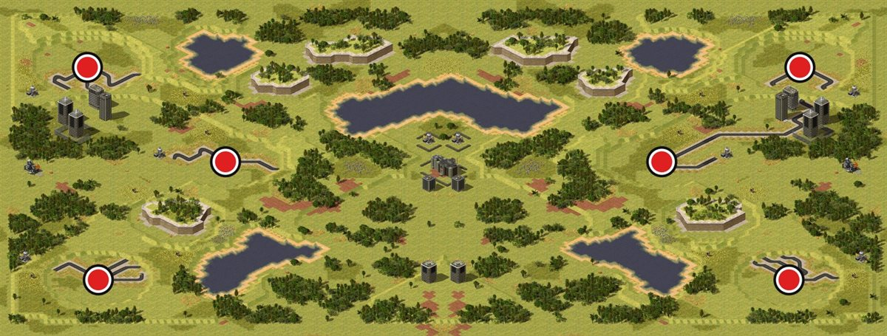 | 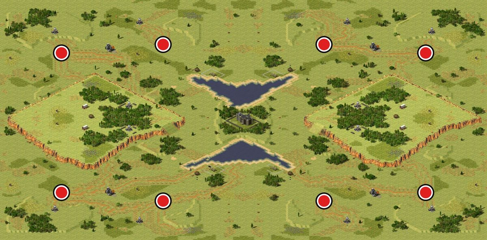 |
| **Tactical cliffs, 3v3, New Urban.** Walls across the approaches and overlooks beside them. | **2v2v2v2, temperate.** Four teams in the corners. |
| 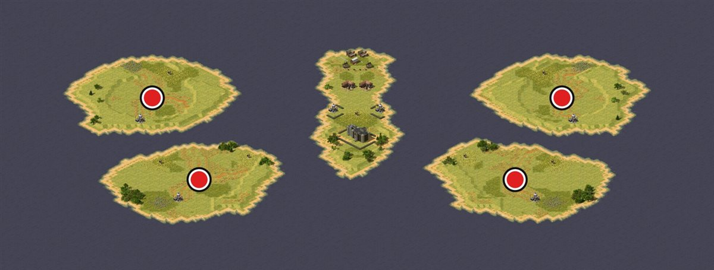 | 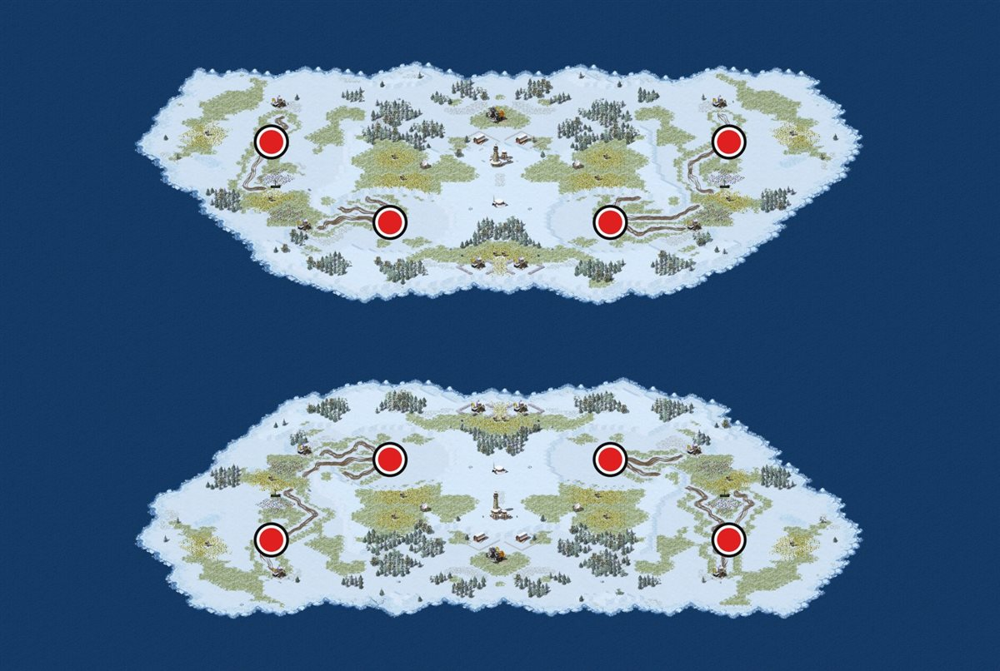 |
| **Archipelago, 2v2.** An island per player and contested islets. | **Team islands, 4v4, snow.** |
| 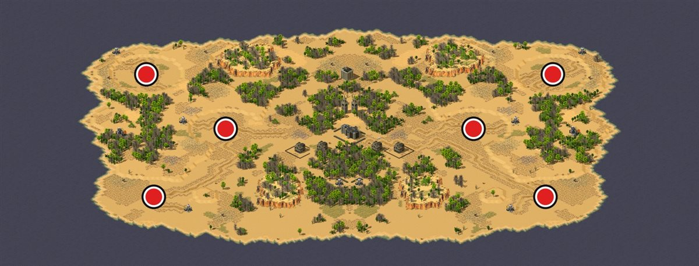 | 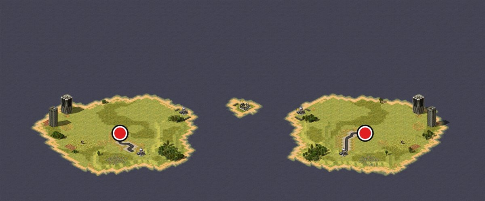 |
| **Continent, 3v3, desert.** | **Player islands, 1v1, New Urban.** |
| 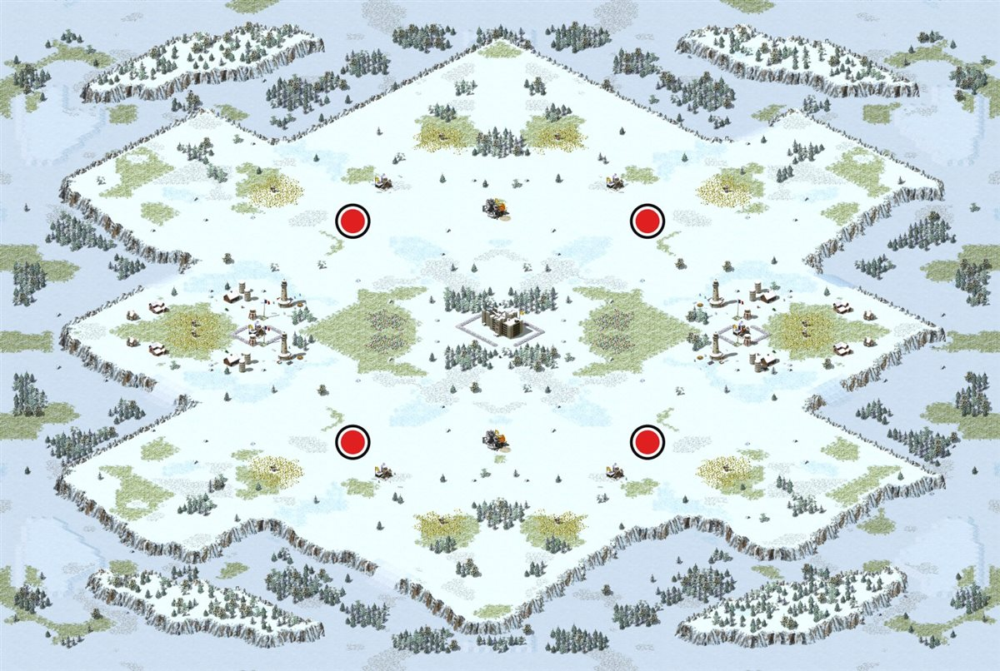 | 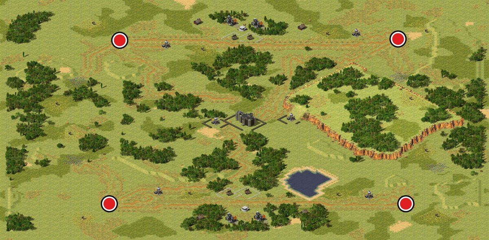 |
| **Mountainous, 2v2, snow.** | **Asymmetry 100%, 2v2.** Starts, fields and tech drift off their mirror spots; fairness is measured. |
| 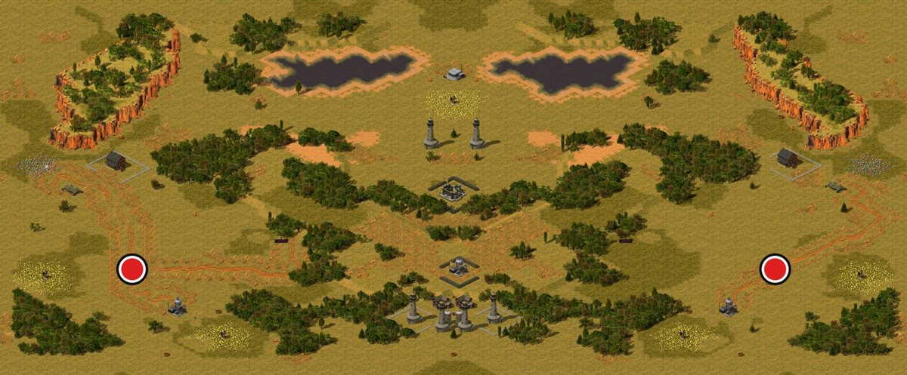 | 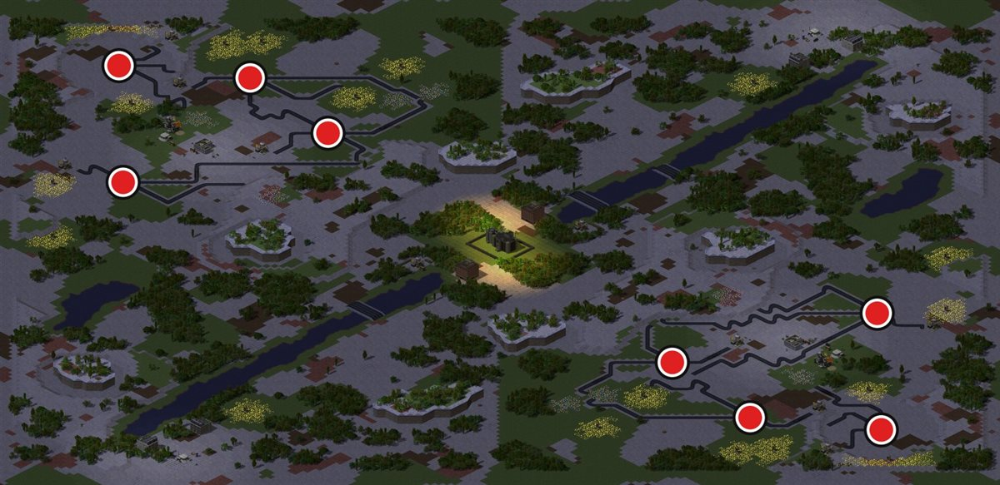 |
| **Dusk, 1v1.** | **Night, 4v4, urban.** Street lamps and a river with bridges. |
